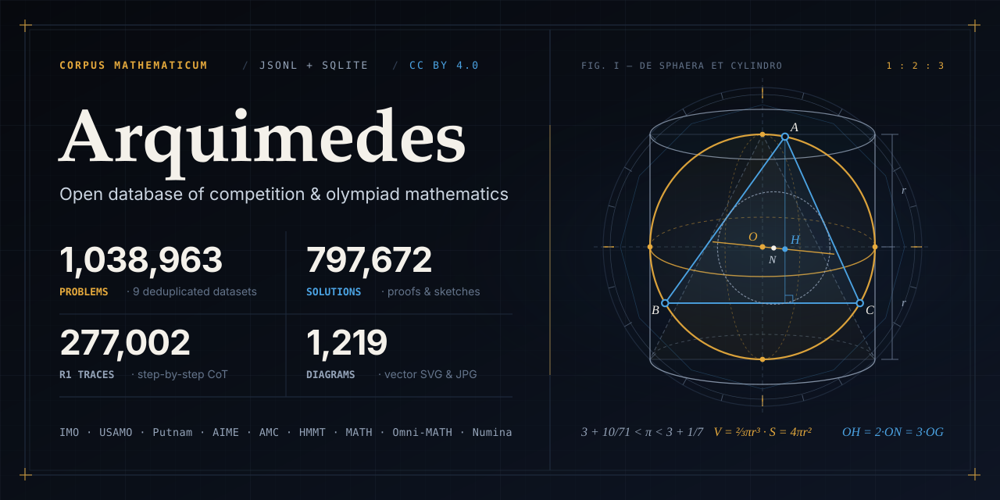

<p align="center">
  
</p>

# Arquimedes: Math Problem Database

A structured, deduplicated database of competition and benchmark mathematics:
**1,038,963 problems** across 9 datasets, each with a normalized LaTeX statement,
calibrated Mohs difficulty (`1.0` to `10.0`), answer metadata, and solutions in a
uniform JSON schema (v2).

- **1,038,963 problems** with full statements and **99.98% domain categorization**
- **797,672 written solutions**: proof-sketch (797,632), strategy (22), answer-only (18)
- **277,002 model-reasoning traces** (`deepmath` dataset, JSONL shards)
- **1,219 diagram images** (SVG and JPG), content-addressed by hash
- **Unified Mohs difficulty (`1.0–10.0`)** populated across all 1,038,963 records
- **Fast CLI & MCP Server**: installable via `uv` (`arquimedes` CLI and `arquimedes-mcp` server)
- **Decontaminated Train/Eval Splits**: one-command export (`972,458` decontaminated train / `10,533` canonical eval)
- **Interactive Web Explorer**: minimalistic browser catalog in [`site/`](site/index.html) ready for GitHub Pages

## Datasets

| dataset | contents | problems | notable fields |
|---|---|---:|---|
| `numina` | NuminaMath problems, the largest dataset | 840,924 | origin tags per problem, Mohs difficulty `1.0–9.5` |
| `deepmath` | DeepMath problems with R1 reasoning traces | 92,334 | three model-reasoning traces per problem, difficulty rating `1–10` |
| `bigmath` | Big-Math-RL-Verified problems with verified answers | 77,527 | Llama-8B solve-rate difficulty note, hierarchical domain tags |
| `math` | MATH benchmark problems | 12,401 | difficulty levels `1` to `5`, train/test split tags |
| `core` | curated competition problems (AMC program, IMO, HMMT, and more) | 10,645 | concept tags, course/source difficulty ratings, progressive hints, solve time |
| `omnimath` | Omni-MATH olympiad problems | 2,640 | difficulty rating from `1` to `9.5`, contest origin tags |
| `olympiadbench` | OlympiadBench olympiad problems | 1,389 | diagram images (JPG), answer-type tags |
| `cemc` | CEMC multiple-choice contests (Gauss, Pascal, Cayley, Fermat) | 792 | five answer choices per problem, reference URLs |
| `aops` | competition problems with community-written solutions | 311 | collection, year, and problem code per record |

## Category Distribution

| category | problems | share |
|---|---:|---:|
| `algebra` | 386,699 | 37.22% |
| `geometry` | 243,231 | 23.41% |
| `arithmetic` | 183,930 | 17.70% |
| `number-theory` | 129,482 | 12.46% |
| `probability` | 38,809 | 3.74% |
| `combinatorics` | 35,493 | 3.42% |
| `logic-foundations` | 19,935 | 1.92% |
| `problem-solving-techniques` | 1,225 | 0.12% |
| `uncategorized` | 159 | 0.02% |

Per-dataset category breakdowns and field notes: [`docs/datasets.md`](docs/datasets.md).

## Competition Coverage

The `source.collection` field labels records that come from a named
competition or benchmark:

- **AMC program (`core`)**: AHSME 1,810 · AMC 8 1,025 · AMC 10A 625 · AMC 10B 625 · AMC 10 50 · AMC 12A 625 · AMC 12B 625 · AMC 12 50 · AIME I 405 · AIME II 405 · AIME 255 · USAMO 153 · USA TST 45 · USA TSTST 48
- **IMO (`core`)**: 156
- **HMMT (`core`)**: February 2,606 · November 1,072 · Invitational 65
- **CEMC (`cemc`)**: Gauss (Grade 7) 174 · Gauss (Grade 8) 166 · Pascal (Grade 9) 134 · Cayley (Grade 10) 150 · Fermat (Grade 11) 168
- **AoPS (`aops`)**: IMO Shortlist 102 · USAJMO 91 · Canadian MO 83 · APMO 28 · Putnam 7
- **OlympiadBench (`olympiadbench`)**: 1,389
- **MATH (`math`)**: 12,401

Records in `omnimath`, `deepmath`, `numina`, and `bigmath` carry origin and domain labels in `source.tags`.

## CLI & MCP Server (`uv`)

`arquimedes` ships a zero-dependency Python package with both a fast CLI (`arquimedes`) and a Model Context Protocol server (`arquimedes-mcp`) backed by SQLite + `FTS5` (with automatic JSONL shard fallback when SQLite is absent).

```bash
# Build the local 1.7 GB SQLite + FTS5 database (~50 seconds)
uv run arquimedes build
# or a 0.8 GB index that reads solutions from the shards
uv run arquimedes build --lean

# Show corpus summary
uv run arquimedes stats

# Sub-20ms full-text search across 1,038,963 problems
uv run arquimedes search "Cauchy-Schwarz" --min-mohs 7.0 -n 5

# Sample calibrated problems by competition, category, or Mohs difficulty
uv run arquimedes sample --competition IMO --category geometry -n 3

# Inspect a full problem record with choices, answer, hints, and proof
uv run arquimedes show prob.ahsme-1950-p10
```

### MCP Server Configuration (Claude Desktop / Cursor / Glama)

Add to your `mcp.json` or `claude_desktop_config.json`:

```json
{
  "mcpServers": {
    "arquimedes": {
      "command": "uv",
      "args": ["--directory", "/path/to/arquimedes", "run", "arquimedes-mcp"]
    }
  }
}
```

Exposed MCP tools:
- `arquimedes_stats`: dataset, category, competition, and solution counts
- `arquimedes_search`: full-text search with category, dataset, competition, and `min_mohs`/`max_mohs` filters
- `arquimedes_sample`: stratified random problem sampler for worksheets and evaluations
- `arquimedes_get_problem`: fetch full LaTeX statement, choices, verified answer, hints, solutions, and R1 traces by ID

## Decontaminated Train / Eval Splits

For LLM post-training and RLVR (Reinforcement Learning with Verifiable Rewards), `tools/export_splits.py` (or `uv run arquimedes splits`) produces a **decontaminated training set** and a **canonical evaluation benchmark**:

```bash
uv run arquimedes splits --out-dir splits/
```

- **Evaluation split (`splits/eval.jsonl.gz` — 10,533 problems)**: `math` test split (4,974), `omnimath` (2,640), `olympiadbench` (1,389), `core` 2023+ contests (931), `aops` (311), and `cemc` 2023+ contests (288).
- **Decontaminated training split (`splits/train.jsonl.gz` — 972,458 problems)**: filters out 46,057 unverifiable records and strips **9,915 near-duplicate benchmark leaks** detected via 5-gram token shingle overlap across `numina`, `bigmath`, `core`, `math`, `deepmath`, and `cemc`.

## Quickstart (Python & SQLite)

Read a problem directly from a shard with the Python standard library:

```python
import gzip, json

with gzip.open("problems/core/shard-00000.jsonl.gz", "rt", encoding="utf-8") as fh:
    prob = json.loads(fh.readline())

print(prob["title"], "Mohs:", prob["difficulty"]["mohs"])
print(prob["statement"])               # raw LaTeX with \( \) delimiters
print(prob["answer"])                  # {'letter': 'd', 'value': '3+\\sqrt6'}
print(prob["solutions"][0]["text"][:200])
```

Query SQLite + FTS5 directly:

```sql
SELECT p.id, p.title, p.difficulty_mohs, p.answer_value
FROM problems_fts f
JOIN problems p ON p.rowid = f.rowid
WHERE problems_fts MATCH '"pigeonhole"'
  AND p.difficulty_mohs BETWEEN 5.0 AND 8.5
LIMIT 10;
```

## Layout

```
problems/<dataset>/shard-*.jsonl.gz   gzipped JSON Lines, one v2 problem record per line
images/<hash>.svg, images/<hash>.jpg  1,219 content-addressed diagram files
data/index.json                       summary index (counts by dataset, category, competition)
data/problems.sqlite                  queryable SQLite + FTS5 database (build locally)
arquimedes/                           uv-installable CLI and MCP server package
site/                                 minimalistic interactive web explorer (GitHub Pages)
tools/                                converters, shard normalizer, split exporter, DB builder
docs/                                 schema, usage, and dataset documentation
```

## Documentation

- [`docs/schema.md`](docs/schema.md): full v2 record reference, shard format, SQLite + FTS5 schema, LaTeX convention, image store
- [`docs/usage.md`](docs/usage.md): CLI, MCP server, SQL & FTS5 queries, reasoning traces, decontaminated splits
- [`docs/datasets.md`](docs/datasets.md): per-dataset contents, field notes, category distributions, deduplication rules

## License

Problem data, images, and derived files are available under CC BY 4.0. The code and tools under `arquimedes/` and `tools/` are available under the MIT License. See [LICENSE](LICENSE).
